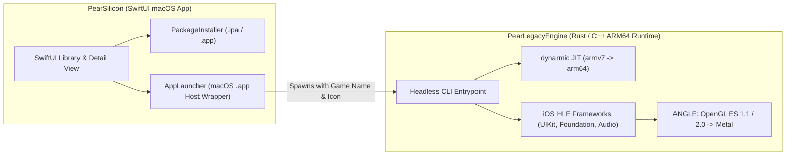

<h1 align="center">PearLegacyEngine</h1>

<p align="center">
  <strong>Apple Silicon 32-bit iOS Compatibility Runtime for <a href="https://github.com/denizomer10/PearSilicon">PearSilicon</a></strong>
</p>

<p align="center">
  
  
  
  
</p>

---

**PearLegacyEngine** is the dedicated 32-bit iOS high-level compatibility runtime engine built for **[PearSilicon](https://github.com/denizomer10/PearSilicon)** on Apple Silicon Macs (`aarch64-apple-darwin`, macOS Sequoia / macOS 26 Tahoe and newer).

Modern macOS and Apple Silicon hardware natively dropped 32-bit ARM (`armv7` / `armv6`) execution, meaning Apple’s Mac Catalyst and `/System/iOSSupport` stack can only run 64-bit (`arm64`) iOS binaries. **PearLegacyEngine** bridges this gap as a dependent runtime component of PearSilicon: while PearSilicon provides the native SwiftUI library manager, `.ipa` / `.app` installer, per-game settings UI, and macOS application host wrapper, PearLegacyEngine executes legacy 32-bit iOS games in the background with native-speed JIT translation (`dynarmic` ARM32 → Apple Silicon ARM64) and high-level framework implementations (UIKit, Foundation, CoreAnimation, OpenGL ES 1.1 & 2.0, AudioToolbox / OpenAL).

---

## Relationship with PearSilicon

PearLegacyEngine is designed as a **headless-controlled companion runtime** rather than a standalone desktop launcher:

- **No Legacy SDL Picker UI:** The standalone SDL app picker GUI is disabled. All library management, IPA installation, free window resizing, fullscreen configuration, and save-data inspection are handled natively in SwiftUI by **[PearSilicon](https://github.com/denizomer10/PearSilicon)**.
- **Zero Engine Branding in Game Windows:** When PearSilicon launches a 32-bit iOS title through PearLegacyEngine, it wraps the runtime inside a lightweight per-game macOS `.app` host bundle with the game’s own `CFBundleName`, `CFBundleDisplayName`, icon, and window title. Only the game’s own name appears in the macOS title bar, menu bar, and Dock.
- **Unified Library & Sandbox Storage:** Game sandboxes (`Documents`, `Library`, `tmp`) and logs are routed directly into PearSilicon’s managed storage tree (`~/Library/Application Support/PearSilicon/Legacy32/`) via `PEAR_LEGACY_SANDBOX_ROOT` and `PEAR_LEGACY_RESOURCES_DIR`.

---

## Key Features & Apple Silicon Optimizations

- **ARM32 → ARM64 JIT on Apple Silicon:** Compiled with `-C target-cpu=apple-m1`, ThinLTO (`lto = "thin"`), single codegen unit, and `opt-level = 3` for low-latency 32-bit ARM translation on M-series chips.
- **OpenGL ES 1.1 & OpenGL ES 2.0 on Metal via ANGLE:**
  - The full graphics stack runs through a bundled **ANGLE** build (`libEGL.dylib` + `libGLESv2.dylib`, Metal backend): the engine creates EGL contexts and window surfaces over a `SDL_Metal` view, and GLES 1.1 / 2.0 commands execute on ANGLE's Metal renderer — no deprecated OpenGL framework usage anywhere. All contexts (guest and presentation) live in one EGL share group so renderbuffers and textures cross contexts freely.
  - Guest `presentRenderbuffer` presentation is a unified internal-ES1 blit path (shared-renderbuffer FBO attach → `CopyTexImage2D` → fullscreen quad), independent of the guest's GL state.
  - Zero-syscall hot render loop (`presentRenderbuffer` environment flags cached once via `LazyLock`, zero unguarded dyld debug logging overhead, and silent stdout/stderr capture when managed by PearSilicon).
- **Expanded iOS Framework Coverage (Miku Flick & iOS 4/5 Games):**
  - **Foundation:** `NSKeyedArchiver` / `NSKeyedUnarchiver` (`initForReadingWithData:`, `initForWritingWithMutableData:`, `encodeObject:forKey:`, `decodeObjectForKey:`, `finishEncoding`), lossy-safe `NSString` UTF-8/Shift-JIS fallback, `NSFileManager` directory creation, `NSHTTPCookieStorage`, `NSBundle`, `NSUserDefaults`, and `NSRunLoop`.
  - **CoreFoundation & libSystem:** `CFAbsoluteTimeGetCurrent`, stack smash protection symbols (`___stack_chk_guard`, `___stack_chk_fail`), and Grand Central Dispatch / pthread shims.
  - **AudioToolbox & OpenAL:** `AudioUnitGetProperty` / `AudioUnitSetProperty` across Global/Input/Output scopes, `AVAudioPlayer`, and hardware-accelerated OpenAL Soft output.
  - **UIKit & CoreAnimation:** Multi-touch input forwarding, `CAEAGLLayer` fullscreen fast-path presentation, Retina high-DPI window scaling, and `UIAccelerometer` simulation.
- **Free Window Resizing:** The game window can be resized freely at any time. The internal render resolution and touch coordinates stay locked to the game's own coordinate space — stretching is presentation-only, so gameplay and input never break. The legacy `1x`–`4x` scale-hack factors are gone (`--scale-hack=` is accepted but ignored for compatibility).
- **Keyboard & Gamepad Keymapper:** Native desktop key bindings for touch-only games, read from the same JSON keymaps PearSilicon edits (`pear-keymap/v1`). Supports `tap`, `hold`, `swipe` and an analog `joystick` with dead-zone. Works for 32-bit titles too, since it is implemented inside the engine rather than injected as a dylib.
- **Performance HUD:** `PEAR_FPS_HUD=1` draws an in-engine, zero-allocation 7-segment frame-rate overlay over the game viewport (the honest equivalent of Metal HUD for an OpenGL ES renderer), while `--print-fps` keeps logging the same numbers.
- **Headless-first:** No engine picker window, no engine name in the window title or menu bar. The process only ever shows the currently running game.

---

## Architecture Overview



---

## Building from Source (macOS Apple Silicon)

### Prerequisites

- Apple Silicon Mac (`arm64`) running **macOS 26 (Tahoe) or newer**. The engine is arm64-only and contains no x86_64 or Android code.
- Xcode Command Line Tools (`xcode-select --install`) including the Metal Toolchain.
- Rust toolchain (`rustup`, stable `aarch64-apple-darwin`).
- CMake (`brew install cmake`) for building bundled native dependencies (`dynarmic`, `SDL2`, `openal-soft`).
- GN + Ninja (`brew install gn ninja`) for building the bundled ANGLE graphics stack.

### Compile Release Binary

```sh
git clone --recursive https://github.com/denizomer10/PearLegacyEngine.git
cd PearLegacyEngine

# Build the bundled ANGLE (Metal) graphics stack first:
(cd vendor/angle && gn gen out/MacMetal --args='is_component_build=true' && ninja -C out/MacMetal libEGL libGLESv2)

MACOSX_DEPLOYMENT_TARGET=26.0 cargo build --release
```

The optimized binary is emitted at `target/release/touchHLE` alongside the runtime asset directories:

- `touchHLE_dylibs/` — guest ARM32 dynamic libraries (`libgcc`, `libstdc++`, `libobjc`).
- `touchHLE_dylibs/angle/` — the ANGLE Metal runtime (`libEGL.dylib`, `libGLESv2.dylib` and their support dylibs, from `vendor/angle/out/MacMetal/`).
- `touchHLE_fonts/` — fallback system fonts (Liberation & Noto CJK).
- `touchHLE_default_options.txt` — per-title default compatibility flags.

### SDL2 macOS Patch

The bundled SDL2 (via `sdl2/bundled`) carries a local macOS fix in
`patches/SDL-cocoaopengl-multiple-contexts.patch` (retained from the legacy
OpenGL path; harmless with ANGLE). Apply it when building from a fresh
checkout:

```sh
git -C "$(dirname "$(find ~/.cargo/git/checkouts/rust-sdl2-* -name SDL -maxdepth 3 | head -1)")" \
  apply "$PWD/patches/SDL-cocoaopengl-multiple-contexts.patch"
```

### Bundling into PearSilicon

When building **[PearSilicon](https://github.com/denizomer10/PearSilicon)** via `./scripts/build-app.sh release`, PearSilicon automatically detects `/Users/mac/PearLegacyEngine` (or `PEARSILICON_LEGACY_ENGINE_SRC`), bundles the release binary and runtime resources into `PearSilicon.app/Contents/Resources/PearLegacyEngine/`, and signs the application bundle.

---

## Controls & Keymaps

PearSilicon writes keymaps to
`~/Library/Application Support/PearSilicon/Keymaps/<bundle-id>.json` and passes
the file through `PEAR_KEYMAP`. Each binding maps a keyboard key to a gesture on
the emulated touch screen:

```json
{
  "version": "pear-keymap/v1",
  "bindings": [
    { "source": "keyboard", "key": "space", "action": "tap", "_0": { "x": 0.516, "y": 0.911 } },
    { "source": "keyboard", "key": "w", "action": "swipe",
      "_0": { "x": 0.5, "y": 0.8 }, "to": { "x": 0.5, "y": 0.3 }, "duration_ms": 150 },
    { "source": "keyboard", "key": "d", "action": "joystick",
      "center": { "x": 0.14, "y": 0.72 }, "radius": 0.10 }
  ]
}
```

- Coordinates are normalised `0..1` against the game viewport, top-left origin.
- `hold` keeps one stable finger down for as long as the key is held; `swipe`
  interpolates moves over `duration_ms`; `joystick` drags from `center` towards
  the pressed direction with a `0.15` dead zone, so `wasd`/arrows work.
- Bindings with `"source": "controller"` are ignored here — those are handled
  by PearSilicon's GameController bridge.

---

## Direct CLI Usage (Advanced / Debugging)

PearLegacyEngine is invoked automatically by PearSilicon when you click **Launch** on any 32-bit iOS app in your library. For automated testing or diagnostics, you can also invoke the engine binary directly with a path to a `.app` bundle or `.ipa` archive:

```sh
./target/release/touchHLE /path/to/Game.app --large-window
```

The window is freely resizable while the game keeps its internal resolution and touch mapping; `--scale-hack=N` is deprecated and ignored.

### Environment Variables Used by PearSilicon

| Variable | Description |
| --- | --- |
| `PEAR_LEGACY_SANDBOX_ROOT` | Directory where `Saves/<bundle-id>/` save data (`Documents`, `Library`, `tmp`) is stored. |
| `PEAR_LEGACY_RESOURCES_DIR` | Directory containing `touchHLE_dylibs/`, `touchHLE_fonts/`, and `touchHLE_default_options.txt`. |
| `PEAR_ANGLE_LIB_DIR` | Optional override for the ANGLE dylib directory (defaults to `touchHLE_dylibs/angle/`, then `vendor/angle/out/MacMetal/`). |
| `PEAR_LEGACY_LOG_FILE` | Optional file path for standalone log output (omitted by default when PearSilicon captures process logs). |
| `PEAR_TOUCH_SCRIPT` | Optional automated touch sequence (`frame:x:y[:duration],...`) for headless E2E verification. |
| `PEAR_KEYMAP` | Path to a `pear-keymap/v1` JSON file enabling keyboard bindings. |
| `PEAR_FPS_HUD` | `1` draws the in-engine frame-rate overlay over the game. |
| `PEAR_DUMP_FRAME` | Optional path prefix to dump raw RGB framebuffer captures during diagnostics. |
| `PEAR_DEBUG_TOUCH` | Logs every synthesised keymapper touch with its device coordinates. |
| `PEAR_DEBUG_MODULES` | Comma-separated modules to enable verbose `log_dbg!` output for, e.g. `PearLegacyEngine::frameworks::uikit`. |
| `PEAR_KEYMAP_SELFTEST` | Replays one bound tap and one joystick sweep after boot, for headless keymapper verification. |
| `PEAR_HUD_SELFTEST` | One-shot readback that counts overlay pixels, proving the HUD really rendered. |

---

## Credits & License

PearLegacyEngine is built upon the open-source foundations of [touchHLE](https://github.com/touchHLE/touchHLE) and [HyperHLE-Reborn](https://github.com/HyperHLE/HyperHLE-Reborn), adapted and optimized as the 32-bit iOS compatibility layer for **[PearSilicon](https://github.com/denizomer10/PearSilicon)**.

- **Source Code License:** Mozilla Public License 2.0 (MPL-2.0).
- **Binary Distribution License:** GNU General Public License v3.0 or later (GPL-3.0-or-later).
- Bundled dynamic libraries (`touchHLE_dylibs/`) and fonts (`touchHLE_fonts/`) are covered by their respective licenses.

